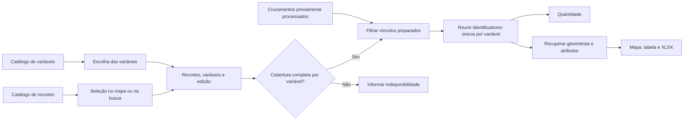

# Modelo lógico da consulta territorial

## Finalidade

Orientar a equipe e a IA sobre o significado dos dados, suas relações e a formação dos resultados. A implementação do banco, dos serviços e da interface deve reproduzir essas regras. O [catálogo de dados](DADOS.md) descreve os conjuntos disponíveis e o [funcionamento da plataforma](FUNCIONAMENTO_PLATAFORMA.md) descreve as interações.

## 1. Conceitos e identidades

| Conceito | Significado | Exemplo |
| --- | --- | --- |
| Tipo de recorte | Categoria territorial usada para localizar unidades selecionáveis. | Município, ATI ou assentamento. |
| Recorte | Unidade territorial identificada, com nome e geometria. Sua identidade deve distinguir a unidade em todo o catálogo. | Município MUN_001. |
| Seleção territorial | Conjunto de identificadores dos recortes escolhidos pelo usuário, inclusive de tipos diferentes. | MUN_001 e ATI_002. |
| Variável | Categoria de informação que o usuário deseja consultar. | PTR, CAR ou ASSENTAMENTOS. |
| Registro de variável | Ocorrência individual, com identidade estável, geometria e atributos próprios. | CAR_003 da variável CAR. |
| Cruzamento preparado | Vínculo previamente identificado entre um recorte e um registro de uma variável na edição correspondente. | O recorte 10 intersecta o registro PTR 3. |
| Cobertura | Informação sobre a completude do processamento de uma variável para um recorte em determinada edição. | CAR completo para MUN_001. |
| Edição dos dados | Referência consistente das fontes, geometrias, atributos e cruzamentos usados em uma consulta. | ED_2026_11 na demonstração. |
| Atributos | Informações descritivas do registro, com campos específicos por variável. | Área declarada de um CAR ou competência de um PTR. |
| Acervo | Conjunto de referências cartográficas que o usuário pode visualizar independentemente da seleção. | Eixo do rio. |

O identificador de um registro deve ser interpretado junto de sua variável. PTR 1 e CAR 1 podem ser ocorrências diferentes. O identificador de um recorte deve ser inequívoco mesmo quando os cadastros de origem usam códigos iguais em categorias distintas. Preserve a correspondência entre a identidade da plataforma e a identidade de origem.

## 2. Da seleção ao resultado

| Passo | Informação usada | Resultado necessário |
| --- | --- | --- |
| 1. Localizar territórios | Tipo ativo e termo de busca, clique ou desenho. | Identificadores de unidades territoriais cadastradas. |
| 2. Formar a seleção | Identificadores já escolhidos e unidades acrescentadas ou removidas. | Conjunto sem duplicatas de recortes acumulados. |
| 3. Definir a consulta | Recortes, variáveis escolhidas e edição. | Contexto completo para obter os resultados. |
| 4. Verificar cobertura | Situação de cada par recorte e variável na edição. | Saber quais variáveis podem apresentar resultados completos. |
| 5. Reunir vínculos | Cruzamentos prontos dos recortes selecionados para cada variável completa. | Identificadores dos registros relacionados a qualquer recorte escolhido. |
| 6. Eliminar repetições | Identidades dos registros dentro de cada variável. | Um conjunto único por variável. |
| 7. Apresentar | Mesmo conjunto de identidades, atributos e geometrias da edição. | Quantidade, mapa, tabela e exportação coerentes. |

## 3. Significado de um cruzamento

Cada ocorrência na base de cruzamentos representa **um vínculo único entre um recorte e um registro de uma variável, em uma edição dos dados**. Várias partes de uma geometria que intersectam o mesmo recorte continuam representando um único vínculo para esse par.

No exemplo do recorte 10, há quatro registros de PTR relacionados a ele.

| Recorte | Variável | Registro |
| --- | --- | --- |
| 10 | PTR | 1 |
| 10 | PTR | 2 |
| 10 | PTR | 3 |
| 10 | PTR | 4 |

Com cobertura completa, selecionar o recorte 10 e PTR retorna a quantidade **4**, as geometrias desses quatro registros e seus atributos. A sigla PTR representa a categoria selecionada. Os identificadores 1 a 4 representam as ocorrências contadas.

Os atributos completos pertencem aos registros das fontes. O vínculo permite recuperá-los pela identidade e pela edição. O resultado quantitativo é derivado dos registros encontrados.

## 4. Combinação de recortes e inclusão espacial

| Regra | Aplicação | Exemplo |
| --- | --- | --- |
| União territorial | Incluir registros relacionados a pelo menos um dos recortes escolhidos. | A tem CAR 1, 2 e 3, B tem CAR 3 e 4. A seleção de A e B retorna 1, 2, 3 e 4. |
| Deduplicação por variável | Contar um registro uma única vez, mesmo que tenha vínculos com vários recortes selecionados. | CAR 3 conta uma vez na consulta conjunta. |
| Resultados independentes | Manter um conjunto de registros e uma quantidade para cada variável. | PTR e CAR têm seções próprias. |
| Interseção inclusiva | Um ponto em comum é suficiente para vincular geometrias, incluindo contato de borda, sobreposição parcial e contenção. | Um CAR que apenas encosta no recorte entra inteiro. |
| Geometria completa | Considerar partes separadas e furos de polígonos. Usar o teste espacial das geometrias para decidir inclusão. | Um registro localizado inteiramente em um furo, sem tocar sua borda, fica fora. |
| Unidade inteira | A seleção usa o recorte completo e a contagem usa registros inteiros. | Um polígono com duas partes continua sendo uma unidade. |
| Desenho | Usar a geometria desenhada para encontrar recortes existentes do tipo ativo. A consulta utiliza os recortes encontrados. | Tocar um município pelo desenho seleciona o município inteiro. |
| Assentamentos em dois papéis | Compartilhar identidade e geometria do assentamento usado como recorte e como registro consultável. | Selecionar AST_001 encontra o próprio AST_001 e outros assentamentos intersectados. |
| Composição de ATI | Manter a lista dos municípios integrantes vinculada à definição do território. | A fonte permite identificar os membros de ATI_002 e a geometria correspondente. |

Preparar vínculos de cada recorte com os registros permite combinar livremente os territórios durante a navegação. A união dos resultados é obtida reunindo os identificadores já relacionados aos recortes selecionados. A preparação cobre os recortes individuais do catálogo.

## 5. Zero, indisponibilidade e falha

| Situação | Interpretação | Resposta |
| --- | --- | --- |
| Todos os recortes têm cobertura completa para a variável e existem vínculos. | O conjunto foi consultado integralmente. | Quantidade de registros únicos e dados correspondentes. |
| Todos os recortes têm cobertura completa para a variável e nenhum vínculo foi encontrado. | A consulta válida encontrou ausência de ocorrências. | Quantidade zero e conjunto vazio. |
| Algum recorte tem processamento incompleto, indisponível ou sem confirmação de cobertura. | O conjunto dessa variável ainda não pode ser apresentado como completo. | Indisponibilidade, sem total numérico ou registros parciais, com indicação das pendências. |
| O serviço falha ao executar uma consulta. | Houve uma falha operacional. | Estado de erro e recuperação apropriada. |

A cobertura precisa existir mesmo quando um processamento completo encontra zero vínculos. Se uma variável estiver indisponível, outras variáveis completas da mesma seleção continuam utilizáveis.

## 6. Consistência e atualização

| Aspecto | Orientação para implementação |
| --- | --- |
| Edição | Associar seleção, resultados, atributos e exportação à mesma referência de dados. |
| Atualização de fonte | Conferir mudanças de identidades, geometrias e atributos e atualizar os vínculos e a cobertura afetados antes de disponibilizar os novos resultados. |
| Publicação | Disponibilizar uma edição consistente com o estado conhecido de cada cruzamento. Registrar explicitamente o que está completo e o que está indisponível. |
| Repetição de carga | Garantir que repetir um processamento preserve a unicidade dos vínculos e das identidades. |
| Identidade sem registro correspondente | Tratar como inconsistência de preparação. Recuperar e validar os atributos e geometrias necessários antes de declarar a consulta completa. |
| Consulta em andamento | Fixar o contexto da solicitação e conferir se a resposta ainda corresponde à seleção atual ao apresentá-la. |
| Tabela | Paginação e ordenação apenas organizam a apresentação do conjunto encontrado. |
| Exportação | Fixar a seleção, a edição e os registros na geração do arquivo e exportar o conjunto completo da variável. |
| Navegação e acervo | Zoom, deslocamento do mapa e referências do acervo afetam a visualização. A seleção territorial e as variáveis determinam a consulta. |

## 7. Pontos de integração

Os itens abaixo descrevem as capacidades que a implementação deve fornecer. A equipe pode definir o formato dos serviços e a organização do banco conforme a tecnologia escolhida, preservando as entradas, os resultados e as regras deste documento.

| Necessidade da interface | Informação de entrada | Informação de saída |
| --- | --- | --- |
| Exibir tipos e variáveis | Contexto do projeto e edição quando aplicável. | Catálogos com identidades, nomes, descrições e informações de fonte. |
| Buscar recortes | Tipo ativo, texto e edição. | Unidades com identidade, nome, dados de desambiguação e geometria para apresentação. |
| Selecionar por desenho | Tipo ativo, polígono válido e edição. | Identificadores de recortes inteiros que intersectam ou tocam o desenho. |
| Adicionar novo acordo | Grupo oficial validado e edição. | Identificadores dos 49 municípios ou indicação de indisponibilidade. |
| Consultar | Conjunto de recortes, conjunto de variáveis e edição. | Estado por variável, quantidade quando completa, registros únicos e pendências quando houver. |
| Mostrar atributos e mapa | Identidades dos registros, variável e edição da consulta. | Atributos completos, geometrias e configuração de apresentação das colunas. |
| Exportar | Consulta e variável de interesse. | Todos os registros daquela variável e o contexto que descreve o resultado. |
| Consultar acervo | Camada de referência e edição quando aplicável. | Feições e informações descritivas independentes da seleção analítica. |

No protótipo, essas capacidades são demonstradas pelo adaptador BI.api. Os catálogos estão em BI.tipos, BI.recortes e BI.variaveis. Os registros, vínculos, cobertura e edições estão em estruturas próprias de [prototipo/js/data.js](prototipo/js/data.js).

A [ilustração inicial da consulta](prototipo/referencias/diagrama-consulta-territorial-v1.png) está preservada como referência visual do fluxo de seleção e cruzamentos. Os conceitos e as regras deste documento orientam sua implementação.

A arquitetura física, o formato definitivo dos serviços, o volume de dados, as metas de desempenho e as responsabilidades de operação serão definidos pela equipe. Quando implementados, o código e os scripts necessários para reproduzir o banco devem acompanhar a entrega no repositório.
