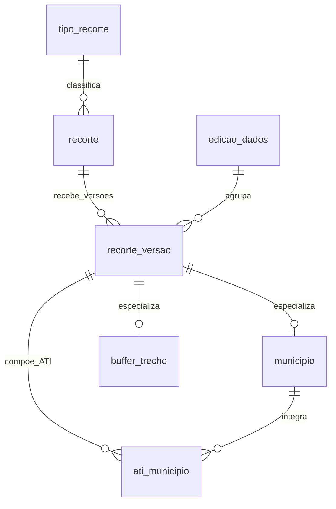
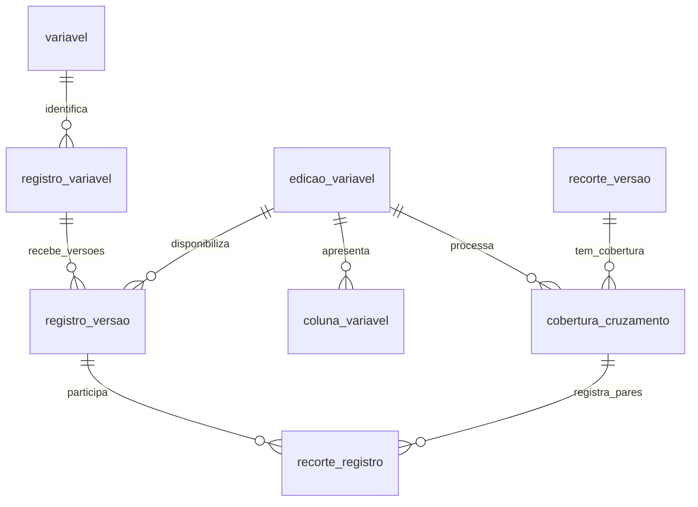

# BI territorial — MDA / Rio Doce
## Modelo de dados e integração com a interface · versão 1.0

**Data:** 4 de novembro de 2026  
**Base funcional:** Especificação funcional BI Rio Doce v1.0, regras RF01–RF12 e critérios CA01–CA15.  
**Destino:** UX, arquitetura de dados e desenvolvimento do backend.  
**Status:** modelo de referência para homologação. Não foi aplicado a um banco de produção. Os atributos específicos das fontes e a definição de PTR permanecem pendentes de mapeamento.

## 1. Leitura principal

A seleção do usuário é uma lista de identificadores de recorte. O banco já conhece quais registros de cada variável intersectam cada recorte. Quando o usuário seleciona vários recortes, a consulta reúne os registros vinculados e elimina repetições. Cada variável continua com seu próprio resultado.

O desenho no mapa serve para localizar e selecionar recortes existentes. Não vira uma nova área de análise. Alternar camadas do acervo só muda a exibição. Não há operação de interseção entre recortes.

O modelo propõe PostgreSQL/PostGIS, geometrias de análise em SIRGAS 2000, EPSG:4674, e entrega de GeoJSON ao navegador em EPSG:4326. Essa é uma escolha técnica de referência, sujeita à homologação da arquitetura. Como a regra é apenas contato espacial, esta versão não calcula distâncias nem áreas. O buffer de 5 km é recebido pronto; não é calculado em coordenadas geográficas durante a consulta.

## 2. Arquivos que compõem a entrega

| Arquivo | Finalidade |
|---|---|
| Modelo_de_Dados_BI_Rio_Doce_v1.md | Diagrama, dicionário, decisões, interações, contratos e critérios de implantação. |
| 01_modelo_bi_rio_doce.sql | DDL de referência, índices, restrições, processamento, publicação e consulta dos IDs únicos. |
| 02_consultas_interface.sql | Consultas parametrizadas Q01–Q10 para as ações da plataforma. |
| 03_validar_modelo.py | Verificação de sintaxe SQL/PL/pgSQL e cenários sintéticos da regra espacial e da união. |
| Validacao_Modelo_Rio_Doce.txt | Resultado e limites das verificações realizadas nesta entrega. |

O SQL de estrutura pressupõe um banco novo de homologação com permissão para criar extensões e o schema `bi_rio_doce`. Não contém exclusão de schema nem migração de estruturas preexistentes. A execução cria apenas catálogos de tipos e variáveis, sem simular dados territoriais reais.

## 3. Decisões de arquitetura

| Decisão | Implementação | Regras atendidas |
|---|---|---|
| Recortes de vários tipos compartilham uma identidade consultável | `recorte` + `recorte_versao` | RF01, RF04–RF06 |
| União sem repetição | Pares únicos em `recorte_registro` + `DISTINCT registro_id` | RF02, RF03 |
| Cada variável preserva seus atributos | Uma tabela própria `metadados_*` e um catálogo `coluna_variavel` | RF08, RF11, RF12 |
| Assentamento tem identidade comum nos dois papéis | `registro_variavel.recorte_assentamento_id` referencia `recorte` | RF08, RF09 |
| Geometria do assentamento é única por edição | View `registro_geometria` resolve a geometria de `recorte_versao`; não há cópia no registro | RF09, RF10 |
| Cruzamentos são preparados | `processar_cruzamentos()` grava todos os pares por variável e edição | RF10 |
| Zero é diferente de ausência de processamento | `cobertura_cruzamento` registra completude inclusive sem pares | RF10, CA13 |
| Navegação usa uma edição consistente | Tabelas versionadas e edições publicadas imutáveis | CA09, CA14 |
| Acervo é independente | `camada_acervo` não integra a consulta de registros | RF07 |
| Seleção não exige tabela de usuários | IDs ficam no estado da interface e são enviados às consultas | RF01 |

A identidade é estável entre edições, enquanto nome, geometria, atributos e relações recebem `edicao_id`. Assim, selecionar um município não depende de sua posição em um vetor ou de um identificador gerado a cada carga.

## 4. Diagramas de relacionamentos

Os diagramas dividem a leitura em dois conjuntos. Os arquivos SQL contêm as chaves compostas que garantem que todos os vínculos pertencem à mesma edição.

### 4.1 Território e recortes



Em `ati_municipio`, o lado ATI é necessariamente um recorte do tipo `ati`; o outro lado é um município. Assentamentos, TIs e territórios quilombolas não exigem tabelas de especialização nesta versão: identidade, nome e geometria já estão no núcleo de recortes.

### 4.2 Variáveis e resultados



Cada `registro_versao` deve possuir uma única ficha na tabela específica de sua variável. As três tabelas iniciais são `metadados_car`, `metadados_ptr` e `metadados_assentamento`. O relacionamento é de um para um na edição publicada, validado pelas chaves e pela publicação. Para assentamentos, há ainda um vínculo de no máximo um registro da variável para cada identidade de recorte.

## 5. Convenções do dicionário

`PK` significa chave primária; `FK`, chave estrangeira; `UQ`, unicidade. Campos são obrigatórios salvo indicação de “opcional”. IDs numéricos são `bigint`; no contrato JSON, recomenda-se representá-los como strings decimais para preservar a precisão no navegador. Códigos de tipo e variável são textos estáveis e não são os rótulos apresentados ao usuário.

Os campos auxiliares de tipo e variável nas chaves compostas são deliberados: impedem associar um CAR à tabela de metadados de PTR ou usar uma TI como município, por exemplo.

## 6. Dicionário de tabelas e campos

### 6.1 Edições e publicação

| Tabela | Campo | Tipo / regra | Finalidade |
|---|---|---|---|
| edicao_dados | edicao_id | bigint, identidade, PK | Identifica uma fotografia consistente do banco. |
| edicao_dados | nome | text | Rótulo da edição. |
| edicao_dados | estado | text: rascunho/publicada | Controla disponibilidade e imutabilidade. |
| edicao_dados | criado_em | timestamptz | Data de criação. |
| edicao_dados | publicado_em | timestamptz, opcional no rascunho | Obrigatória quando publicada. |
| edicao_dados | acordo49_validado | boolean, padrão false | Declara que a composição do novo acordo foi conferida na fonte. |
| edicao_atual | unica | boolean, PK, sempre true | Permite no máximo um apontador. |
| edicao_atual | edicao_id | bigint, FK | Edição publicada sugerida a uma nova navegação. |

A publicação atualiza `edicao_atual`, sem alterar a edição anterior. Uma navegação iniciada com a edição anterior pode continuar consultando-a. Se o produto decidir retirar uma edição antiga, deve fazê-lo por política explícita e avisar a interface para reiniciar a navegação.

### 6.2 Tipos, identidades e geometrias de recorte

| Tabela | Campo | Tipo / regra | Finalidade |
|---|---|---|---|
| tipo_recorte | tipo_recorte_id | text, PK | `buffer_5km`, `municipio`, `assentamento`, `ati`, `terra_indigena`, `territorio_quilombola`. |
| tipo_recorte | nome | text | Rótulo do seletor. |
| tipo_recorte | ordem | integer, UQ | Ordem de apresentação. |
| recorte | recorte_id | bigint, identidade, PK | Identificador da unidade selecionável. |
| recorte | tipo_recorte_id | text, FK | Tipo da unidade. |
| recorte | codigo_origem | text | Chave canônica da fonte; UQ junto com tipo. |
| recorte_versao | edicao_id + recorte_id | bigint, PK composta e FKs | Identifica a versão de cada recorte. |
| recorte_versao | tipo_recorte_id | text, FK composta | Deve coincidir com o tipo da identidade. |
| recorte_versao | nome | text | Nome na busca, mapa e etiquetas. |
| recorte_versao | desambiguador | text, opcional | UF, município ou outro complemento cadastrado. |
| recorte_versao | busca_normalizada | text, preenchido por trigger | Nome + código + desambiguador, sem acentos e em minúsculas. |
| recorte_versao | geometria | geometry(MultiPolygon,4674) | Geometria válida e não vazia da unidade inteira. |

`codigo_origem` deve conter uma chave estável do cadastro, com namespace de fonte quando necessário. Não usar nome como identidade. Mudança de fonte ou recodificação exige uma tabela de correspondência no ETL antes de atribuir novos IDs. Fragmentos geométricos da mesma unidade devem ser consolidados antes da carga.

### 6.3 Especializações dos recortes

| Tabela | Campo | Tipo / regra | Finalidade |
|---|---|---|---|
| municipio | edicao_id + recorte_id | bigint, PK e FK composta | Versão do recorte municipal. |
| municipio | tipo_recorte_id | text fixo `municipio` | Garante o tipo do recorte referenciado. |
| municipio | cd_mun | varchar(7), sete dígitos; UQ na edição | Código municipal, preservado como texto. |
| municipio | sigla_uf | char(2) | UF. |
| municipio | novo_acordo | boolean | Alimenta o atalho dos 49. |
| buffer_trecho | edicao_id + recorte_id | bigint, PK e FK composta | Versão do buffer selecionável. |
| buffer_trecho | tipo_recorte_id | text fixo `buffer_5km` | Garante o tipo. |
| buffer_trecho | trecho | text: alto/medio/baixo; UQ na edição | Identifica cada subdivisão. |
| ati_municipio | edicao_id + ati_recorte_id + municipio_recorte_id | bigint, PK composta | Uma linha por município integrante de cada ATI. |
| ati_municipio | tipo_recorte_id | text fixo `ati` | Impede usar outro tipo no lado ATI. |

O nome municipal está em `recorte_versao.nome`; não precisa ser duplicado em `municipio.nm_mun`. A composição de ATI é um vínculo administrativo, não um cruzamento espacial. A geometria oficial da ATI deve ser conferida com essa composição na carga; o SQL não a recalcula automaticamente.

### 6.4 Catálogo e identidades das variáveis

| Tabela | Campo | Tipo / regra | Finalidade |
|---|---|---|---|
| variavel | variavel_id | text, PK | `ptr_aprovadas`, `assentamentos`, `car`; extensível. |
| edicao_variavel | edicao_id + variavel_id | PK composta, FKs | Define quais variáveis existem na edição. |
| edicao_variavel | nome | text | Rótulo exibido. |
| edicao_variavel | fonte | text | Descrição da fonte efetivamente utilizada. |
| edicao_variavel | data_referencia | date, opcional | Referência temporal conhecida. |
| edicao_variavel | situacao | text: pendente/carregada | A carga precisa ser declarada completa antes do cruzamento. |
| edicao_variavel | tabela_metadados | regclass | Referência controlada à tabela própria de atributos. |
| registro_variavel | registro_id | bigint, identidade, PK | Unidade efetivamente contada. |
| registro_variavel | variavel_id | text, FK | Variável a que pertence. |
| registro_variavel | codigo_origem | text; UQ junto com variável | Identidade canônica da fonte. |
| registro_variavel | recorte_assentamento_id | bigint, FK composta, opcional | Obrigatório exclusivamente para a variável assentamentos. |
| registro_variavel | tipo_recorte_vinculado | text, opcional | Deve ser `assentamento` quando houver o vínculo. |
| registro_versao | edicao_id + registro_id | PK composta e FKs | Versão do registro em uma edição. |
| registro_versao | variavel_id | text, FK composta | Mantém a identidade e a edição consistentes. |
| registro_versao | nome | text | Identificação legível na listagem/inspeção. |
| registro_versao | geometria | geometry(Geometry,4674), condicional | CAR exige MultiPolygon; assentamentos deixam nulo e usam o recorte; outros tipos são definidos ao mapear a fonte. |

A view `registro_geometria` expõe `edicao_id`, `registro_id`, `variavel_id`, `nome` e `geometria`. Para assentamentos, resolve o polígono a partir do recorte na mesma edição. A publicação rejeita registros sem geometria resolvida.

PTR é mantida com geometria genérica até ser definida sua localização real. Isso não significa assumir pontos, polígonos ou uma unidade específica de contagem. O ETL de PTR não pode ser fechado sem essas definições. Apenas PTRs efetivamente aprovadas integrarão essa variável; o critério de aprovação é responsabilidade do mapeamento da fonte.

### 6.5 Tabelas de metadados e configuração das colunas

Cada tabela inicial `metadados_car`, `metadados_ptr` e `metadados_assentamento` possui:

| Campo | Tipo / regra | Finalidade |
|---|---|---|
| edicao_id + registro_id | bigint, PK composta | Uma ficha por registro e edição. |
| variavel_id | text, valor fixo específico de cada tabela | Garante, por FK composta, a variável correta. |
| Colunas da fonte | A definir no mapeamento | Atributos específicos que serão apresentados em “Quais”. |

**O SQL cria a estrutura dessas três tabelas com suas chaves. Não inventa colunas de negócio não informadas.** A equipe acrescentará as colunas reais, com tipos apropriados, antes da carga. Por exemplo, se a fonte CAR trouxer `cod_imovel`, esse campo poderá ser acrescentado à tabela de CAR; o nome e o tipo precisam ser conferidos no dado recebido.

Não há armazenamento obrigatório desses atributos em JSON ou em uma tabela de chave/valor. São colunas relacionais próprias de cada base.

| Campo de coluna_variavel | Tipo / regra | Uso por UX/backend |
|---|---|---|
| edicao_id + variavel_id + nome_coluna | PK composta, FK para edicao_variavel | Identifica uma coluna real da tabela da variável. |
| rotulo | text | Cabeçalho legível. |
| tipo_dado | text | Tipo do contrato de apresentação, conferido com a coluna física pelo ETL. |
| ordem | integer, UQ por edição e variável | Ordem das colunas. |
| visivel | boolean | Define se aparece na tabela. |
| unidade | text, opcional | Unidade quando houver. |
| formato | text, opcional | Máscara ou indicação de apresentação. |

`registro_id` e `nome` são campos fixos do resultado, fora das colunas específicas de metadados. Campos internos `edicao_id` e `variavel_id` não precisam ser apresentados ao usuário.

O catálogo deve ser preenchido por rotina administrativa confiável. A publicação verifica se as colunas cadastradas existem. Compatibilidade entre `tipo_dado`, formato e tipo físico precisa ser conferida no mapeamento da carga. A API usa apenas nomes de tabela e coluna permitidos pelo catálogo; nunca executa um nome enviado livremente pelo navegador.

### 6.6 Cruzamentos e cobertura

| Tabela | Campo | Tipo / regra | Finalidade |
|---|---|---|---|
| cobertura_cruzamento | edicao_id + recorte_id + variavel_id | PK composta e FKs | Uma linha para cada combinação de recorte e variável disponível. |
| cobertura_cruzamento | situacao | pendente/processando/concluido/erro | Distingue processamento incompleto de resultado zero. |
| cobertura_cruzamento | processado_em | timestamptz, obrigatório quando concluído | Rastreia conclusão. |
| cobertura_cruzamento | quantidade | bigint ≥ 0, obrigatório quando concluído | Contagem daquele recorte individual, para conferência. |
| recorte_registro | edicao_id + recorte_id + variavel_id + registro_id | PK composta | Cada par espacial aparece uma única vez na edição. |
| recorte_registro | mesmas colunas | FKs compostas | Exigem cobertura e registro da mesma edição/variável. |

A quantidade individual em `cobertura_cruzamento` não pode ser somada para responder à seleção múltipla. O total da seleção sai dos IDs distintos de `recorte_registro`.

A regra espacial é `ST_Intersects`: inclui contato de borda, sobreposição e contenção. `ST_Touches`, isoladamente, não representaria o comportamento solicitado.

### 6.7 Camadas do acervo

| Campo de camada_acervo | Tipo / regra | Finalidade |
|---|---|---|
| camada_id | bigint, identidade, PK | Identificador do controle visual. |
| nome | text | Nome no painel. |
| descricao | text, opcional | Explicação da camada. |
| referencia_servico | text | Referência controlada a tiles, WMS, GeoJSON ou outro serviço definido pela arquitetura. |
| estilo | jsonb | Configuração de aparência. |
| ordem | integer | Ordem no painel. |
| ativa | boolean | Disponibilidade no catálogo. |

As preferências ligado/desligado ficam no navegador. A tabela não possui FK para seleções nem participa de `ids_resultado`. O acervo tem ciclo próprio de atualização, independente das edições analíticas. Uma camada usada para conferência de resultados deve informar sua referência temporal para evitar confusão visual.

## 7. Matriz botão/clique → campos → consulta

| Controle / ação | Estado da interface | Tabelas e campos | Consulta / efeito |
|---|---|---|---|
| Abrir plataforma | Sem seleção; fixa edicao_id | edicao_atual.edicao_id; tipo_recorte; edicao_variavel | Q01. |
| Escolher tipo | Muda tipo_recorte_ativo | recorte_versao.tipo_recorte_id, edicao_id, geometria | Q02; não recalcula resultados da seleção acumulada. |
| Digitar busca | Expressão dentro do tipo ativo | recorte_versao.busca_normalizada | Q03. |
| Escolher item da busca | Adiciona recorte_id ao conjunto | recorte_versao.recorte_id, nome, geometria | A mesma camada de Q02 fornece o foco; buscar geometria por ID quando necessário. |
| Clicar no mapa | Alterna um ID selecionado | recorte_versao.recorte_id | Usar ID da feição; Q04 para resolver clique com múltiplas feições. |
| Concluir desenho | Adiciona IDs encontrados | recorte_versao.geometria, tipo_recorte_id | Q04; consulta espacial apenas aos recortes. |
| Adicionar os 49 | União dos IDs com a seleção | municipio.novo_acordo; edicao_dados.acordo49_validado | Q05; exige disponibilidade validada. |
| Remover etiqueta | Remove um ID | Estado local, sem escrita no banco | Repete Q06/Q07/Q08 para variáveis selecionadas. |
| Limpar recortes | Esvazia seleção | Estado local | Cancela consultas; apresenta instrução, sem total implícito da bacia. |
| Marcar variável | Adiciona variavel_id | edicao_variavel; recorte_registro | Q06 para a nova variável, usando os mesmos recortes. |
| Ver Quantos | Total de uma variável | ids_resultado → recorte_registro | Q06, contagem de IDs distintos. |
| Ver Quais / paginar | Página por variável | ids_resultado + registro_versao + metadados específicos | Q07, com colunas de coluna_variavel. |
| Mostrar registros no mapa | Representação dos resultados | ids_resultado + registro_geometria | Q08; preserva seleção. |
| Ligar/desligar acervo | Apenas camadas_visiveis | camada_acervo | Q09; sem requisição de contagem. |
| Inspecionar registro | Registro em destaque | registro_geometria + tabela de metadados | Q10 + ficha específica; sem adicionar recortes. |

Exemplo de seleção: município A + TI B. CAR 10 toca ambos; CAR 20 toca apenas A. O total de CAR é dois. O resultado não exige que os registros toquem A e B ao mesmo tempo.

## 8. Contrato sugerido entre interface e backend

Rotas abaixo são propostas para orientar as duas equipes; não constituem uma API já implantada.

| Operação | Entrada essencial | Saída essencial |
|---|---|---|
| GET /catalogo | — | edicao_id atual, tipos, variáveis e disponibilidade do atalho. |
| GET /recortes | edicao_id, tipo_recorte_id, viewport opcional | Feições daquele tipo com IDs estáveis. |
| GET /recortes/busca | edicao_id, tipo_recorte_id, texto | Candidatos identificados e desambiguados. |
| POST /recortes/selecao | edicao_id, tipo_recorte_id, geometria GeoJSON | IDs e nomes encontrados. |
| GET /recortes/novo-acordo | edicao_id | disponível, quantidade e IDs, ou motivo de indisponibilidade. |
| POST /resultados | edicao_id, recorte_ids, variavel_ids, requisicao_id | Resultado independente por variável, quantidade e situação. |
| POST /resultados/registros | edicao_id, recorte_ids, variavel_id, pagina/ordem | Total, colunas e linhas. |
| POST /resultados/mapa | edicao_id, recorte_ids, variavel_id, viewport | Representação cartográfica dos mesmos IDs. |
| GET /registros/{id} | edicao_id e registro_id | Geometria e atributos da variável. |
| GET /acervo | — | Catálogo de camadas; sem seleção analítica. |

Exemplo de requisição de resultados, com identificadores meramente ilustrativos:

```json
{
  "edicao_id": "7",
  "recorte_ids": ["101", "305"],
  "variavel_ids": ["car", "ptr_aprovadas"],
  "requisicao_id": "selecao-18"
}
```

Exemplo de retorno, com números simulados:

```json
{
  "edicao_id": "7",
  "requisicao_id": "selecao-18",
  "resultados": [
    {"variavel_id": "car", "situacao": "ok", "quantidade": 4},
    {"variavel_id": "ptr_aprovadas", "situacao": "ok", "quantidade": 0}
  ]
}
```

O frontend só aplica uma resposta se ela corresponder à requisição e à seleção ainda vigentes. Sem recortes ou sem variáveis, não chama a consulta. No backend, array de recortes vazio, IDs desconhecidos, edição não publicada e cobertura indisponível são erros distintos de zero.

“Quais” retorna `{registro_id, nome, metadados: {...}}`, evitando chaves duplicadas. A API projeta apenas as colunas permitidas, valida limites de página, ordenação, tipos de geometria e tamanho do desenho. Não recebe uma operação de união/interseção: a união é a única semântica disponível.

A edição é validada como publicada em todas as rotas analíticas, não apenas ao consultar IDs. Q01–Q10 são consultas internas de referência, não devem ser expostas como SQL livre ao cliente.

## 9. Sequência de carga e publicação

1. Criar uma edição em rascunho. Reutilizar identidades estáveis e criar somente as ainda inexistentes.
2. Carregar `recorte_versao` com geometrias válidas e convertidas para MultiPolygon/4674. Carregar municípios, trechos do buffer e composição das ATIs.
3. Validar o universo territorial: lista de municípios, três trechos, tipos e composição de ATI. Conferir os 49 na lista oficial e só então marcar `acordo49_validado=true`.
4. Definir as tabelas de metadados e suas colunas reais. Inserir `edicao_variavel`, registros, versões e fichas específicas. Conferir as unidades e a aprovação de PTRs.
5. Preencher `coluna_variavel`, conferindo existência, tipo físico, formato e política de visibilidade. Declarar a carga de cada variável como `carregada`.
6. Executar `processar_cruzamentos(edicao_id, variavel_id)` para cada variável. A rotina usa interseção espacial e grava cobertura concluída inclusive para resultados zero.
7. Executar `publicar_edicao(edicao_id)`. A rotina verifica carga, cobertura, quantidade de vínculos, presença de geometrias, fichas e colunas cadastradas; se o atalho foi validado, exige 49 municípios marcados. Atualiza o apontador atual na mesma transação.
8. A interface inicia novas navegações na edição publicada. Correções posteriores são feitas em nova edição.

Alterações de geometria antes da publicação invalidam a cobertura afetada. Se a geometria alterada for de um assentamento usado como variável, a cobertura dessa variável é invalidada para todos os recortes. O processamento precisa ser repetido antes da publicação.

O SQL bloqueia escritas comuns em tabelas versionadas de edições publicadas. Identidades e códigos de catálogos são permanentes. O acervo pode ser alterado independentemente. Como em qualquer banco, o proprietário pode modificar DDL ou desativar triggers: esse papel deve ficar restrito à administração.

A validação cadastral de universo, três trechos e composição de ATI depende da conferência do ETL; não é substituída pelas restrições SQL. `acordo49_validado` expressa conferência com a fonte, não apenas um teste de quantidade.

## 10. Funções e índices

| Componente | Responsabilidade |
|---|---|
| normalizar_busca_recorte | Prepara pesquisa por nome, código e desambiguador. |
| registro_geometria | Resolve a geometria comum dos registros e o caso especial de assentamentos. |
| processar_cruzamentos | Rotina administrativa de cálculo espacial por edição e variável. |
| publicar_edicao | Confere a edição e muda o apontador atual atomicamente. |
| ids_resultado | Valida a seleção e retorna o conjunto distinto que fundamenta Quantos, Quais e mapa. |
| Triggers de proteção/invalidação | Evitam alteração de edição publicada e marcam cruzamentos afetados como pendentes. |
| GiST nas geometrias | Apoia seleção espacial e preparação dos cruzamentos. |
| B-tree por edição/tipo e edição/variável | Apoia leitura dos catálogos e registros de uma edição. |
| PK de recorte_registro | Impede pares repetidos e apoia consultas pela seleção. |
| Índice inverso de recorte_registro | Apoia inspeção de relações por variável/registro. |

A busca normalizada usa correspondência textual simples no SQL de referência. Se o volume justificar, a arquitetura poderá acrescentar índice por trigramas após medir as consultas. A rotina espacial é uma referência funcional; o plano de execução sobre `registro_geometria` deve ser medido. Em bases grandes, separar o processamento de CAR/PTR do de assentamentos pode melhorar o uso dos índices físicos.

Não há meta de tempo de resposta definida sem conhecer os volumes. Para CAR e assentamentos extensos, usar tiles ou paginação espacial para exibição; não enviar todas as geometrias na primeira resposta. Simplificações de visualização não devem substituir a geometria usada para preparar os vínculos.

## 11. Como acrescentar uma variável

1. Definir unidade de contagem, chave canônica, fonte e geometria da variável.
2. Cadastrar novo `variavel_id` estável.
3. Criar sua tabela relacional de metadados com PK `(edicao_id, registro_id)`, discriminador fixo da variável e FK para `registro_versao`.
4. Aplicar à nova tabela a proteção de edição usada pelas tabelas iniciais. Não esquecer essa etapa: o script só cria triggers para as três tabelas conhecidas.
5. Em uma nova edição, configurar `edicao_variavel.tabela_metadados`, fonte, nome e colunas de apresentação. Carregar registros, geometrias e atributos.
6. Processar os vínculos com os recortes e publicar após as verificações.

A tabela de interface permanece genérica. A inclusão de uma variável exige cadastro e uma migração de sua tabela de atributos; não exige inventar previamente todas as colunas das futuras bases nem alterar a semântica da seleção.

Mudanças de estrutura de metadados devem preservar colunas utilizadas por edições publicadas. Para mudanças incompatíveis, criar outra tabela física e apontar a nova edição a ela. Não remover ou renomear colunas ainda referenciadas por edições antigas.

## 12. Permissões e implantação

O script revoga execução pública das funções do schema. A arquitetura deve criar papéis de administração/carga e de aplicação e conceder somente o necessário. Processamento e publicação são administrativos; o frontend não executa SQL nem escreve nas tabelas de seleção.

A aplicação deve ter acesso apenas a edições publicadas por meio de rotinas ou views autorizadas. Não conceder DDL, `TRUNCATE`, alteração de catálogos ou gravação nas tabelas à conexão de navegação. O SQL entregue não cria usuários nem altera credenciais.

Antes de produção, executar o DDL e as consultas preparadas em PostgreSQL/PostGIS de homologação, concluir o mapeamento das fontes e testar volumes, concorrência da publicação e permissões. O modelo evita fixar dados reais ainda desconhecidos; isso não elimina essas etapas de homologação.

## 13. Rastreabilidade e limite da entrega

| Critérios funcionais | Cobertura no modelo |
|---|---|
| CA01, CA03–CA05 | Tipo ativo e seleção em estado local; Q02–Q05 consultam recortes cadastrados. |
| CA02, CA08, CA09 | Pares processados por ST_Intersects e IDs distintos em ids_resultado. |
| CA06, CA11 | edicao_variavel, tabelas próprias e coluna_variavel. |
| CA07 | Acervo fora do caminho analítico. |
| CA10 | Vínculo estável e geometria compartilhada do assentamento. |
| CA12, CA13 | Validação da seleção e controle explícito de cobertura. |
| CA14 | Edição fixada e requisicao_id no contrato de interface. |
| CA15 | Não existe parâmetro ou estado para interseção entre recortes. |

A entrega fecha a estrutura do banco e sua ligação com os controles da plataforma. Permanecem pendentes os arquivos reais das fontes, a definição de PTR e os campos de negócio. O próximo entregável é o protótipo navegável com dados simulados, usando este modelo e a especificação funcional como referência.
