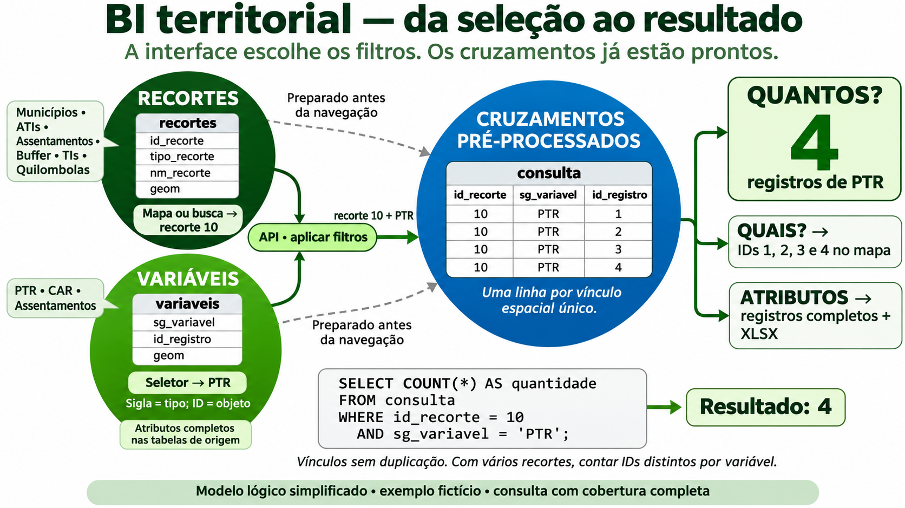
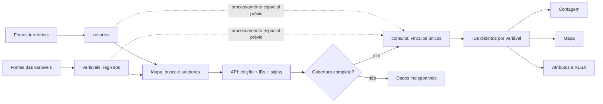

# Modelo lógico — da seleção ao resultado

Estado: proposta de integração, para acordo técnico. Não é DDL de um banco implantado. PostgreSQL/PostGIS é uma opção de implementação; a regra de negócio independe dessa escolha.



A imagem é uma simplificação para apresentação. `sg_variavel` identifica o tipo (PTR, CAR, ASSENTAMENTOS); `id_registro` identifica um objeto dentro desse tipo. `id_recorte` é único entre todos os tipos de território. IDs são strings na API, inclusive quando o armazenamento físico usar números.

## Núcleo

| Objeto | Campos essenciais e função |
| --- | --- |
| `recorte_map` / catálogo de tipos | Tipo, rótulo, fonte de origem. Alimenta o seletor de tipo. |
| `recortes` | `id_edicao`, `id_recorte`, `tipo_recorte`, `id_origem`, `nm_recorte`, `geom`. Alimenta mapa, busca e seleção. |
| `municipio` | Código oficial, UF e indicador do novo acordo vinculados ao recorte. |
| `ati_municipio` | Edição, ATI e municípios integrantes. Composição administrativa explicitamente cadastrada. |
| `var_map` / catálogo de variáveis | Sigla, nome, fonte, chave de origem e definição da unidade de contagem. Seletor usa uma opção por sigla. |
| `variaveis` / registros comuns | `id_edicao`, `sg_variavel`, `id_registro`, nome e geometria. Uma linha por objeto, com identidade estável. |
| Tabelas próprias de atributos | Cada fonte conserva seus campos. Recuperação pela edição, sigla e identificador do registro. |
| `coluna_variavel` | Campo, rótulo, tipo, ordem, visibilidade e formato para apresentar os atributos. |
| `consulta` | `id_edicao`, `id_recorte`, `sg_variavel`, `id_registro`. Uma linha por vínculo espacial único já processado. |
| `cobertura_cruzamento` | Estado por edição, recorte e variável, mesmo quando não há vínculos. |
| `edicao_dados` | Versão consistente de geometrias, atributos e vínculos; proposta: publicar apenas dados validados e não alterá-los depois. |
| `camada_acervo` | Referências cartográficas fora da consulta analítica. |

O núcleo comum pode ser alimentado pelas tabelas de origem. A implementação física de tabelas, views, índices e carga será definida pela equipe técnica. Mapear uma fonte não significa expor nomes de tabela ou SQL livre ao navegador.



## Exemplo de consulta

Para uma edição consistente, a chave única é `(id_edicao, id_recorte, sg_variavel, id_registro)`. Um registro que intersecta o mesmo recorte em várias partes produz apenas um vínculo.

| id_recorte | sg_variavel | id_registro |
| --- | --- | --- |
| 10 | PTR | 1 |
| 10 | PTR | 2 |
| 10 | PTR | 3 |
| 10 | PTR | 4 |

Após verificar cobertura completa, o exemplo retorna quatro:

```sql
SELECT COUNT(*) AS quantidade
FROM consulta
WHERE id_edicao = :edicao
  AND id_recorte = :recorte
  AND sg_variavel = :sigla;
```

Com vários recortes, contar objetos distintos por variável:

```sql
SELECT sg_variavel, COUNT(DISTINCT id_registro) AS quantidade
FROM consulta
WHERE id_edicao = :edicao
  AND id_recorte IN (:recortes)
  AND sg_variavel IN (:siglas)
GROUP BY sg_variavel;
```

Os parâmetros acima são pseudocódigo de parâmetros vinculados, a adaptar ao driver; não concatenar entradas do usuário em SQL. A consulta de IDs é a mesma base da contagem, geometria e atributos. Variáveis completas sem vínculos precisam receber zero na resposta, mesmo que `GROUP BY` não produza linha. Cobertura incompleta é tratada antes da contagem, por variável, sem publicar somas parciais.

## Interface e backend

- Tipo ativo → listar apenas suas unidades. Trocar tipo não apaga IDs já selecionados.
- Clique/busca → conservar `id_recorte` no estado. Desenho → API retorna IDs dos recortes inteiros intersectados.
- Seletor de variável → conservar `sg_variavel`, nunca confundir com o ID de um objeto.
- Resultado → enviar edição, IDs, siglas e identificador de requisição.
- Tabela/mapa/exportação → mesma seleção e edição; recuperar atributos/geometria dos mesmos IDs.
- Assentamentos → identidade e geometria compartilhadas nos dois papéis; evitar cópias divergentes.

No protótipo, `BI.recortes`, `BI.variaveis`, `BI.registros`, `BI.vinculos`, `BI.cobertura` e `BI.api` simulam esses componentes. Os nomes internos (`id`, `tipo`, `estado`) não são o contrato HTTP. O adaptador da implementação final deve mapear os campos definidos em `contratos/openapi.json`.
